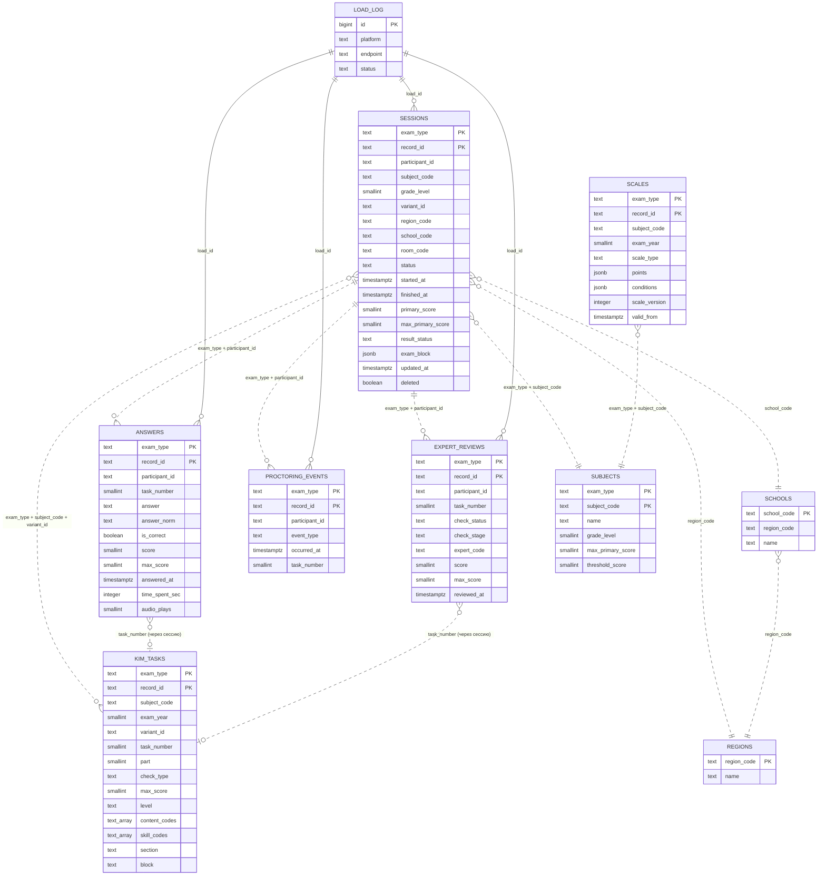

# ER-диаграмма схемы core

Сплошные линии — внешние ключи в базе (load_id → ops.load_log). Пунктирные — связи по смыслу:
в базе они не ограничены ключами (раздел 7.2) и проверяются в качестве данных (раздел 13).

Во всех таблицах core с данными платформ также есть payload (jsonb), loaded_at и load_id;
у справочников и core.live_status — loaded_at и load_id.
